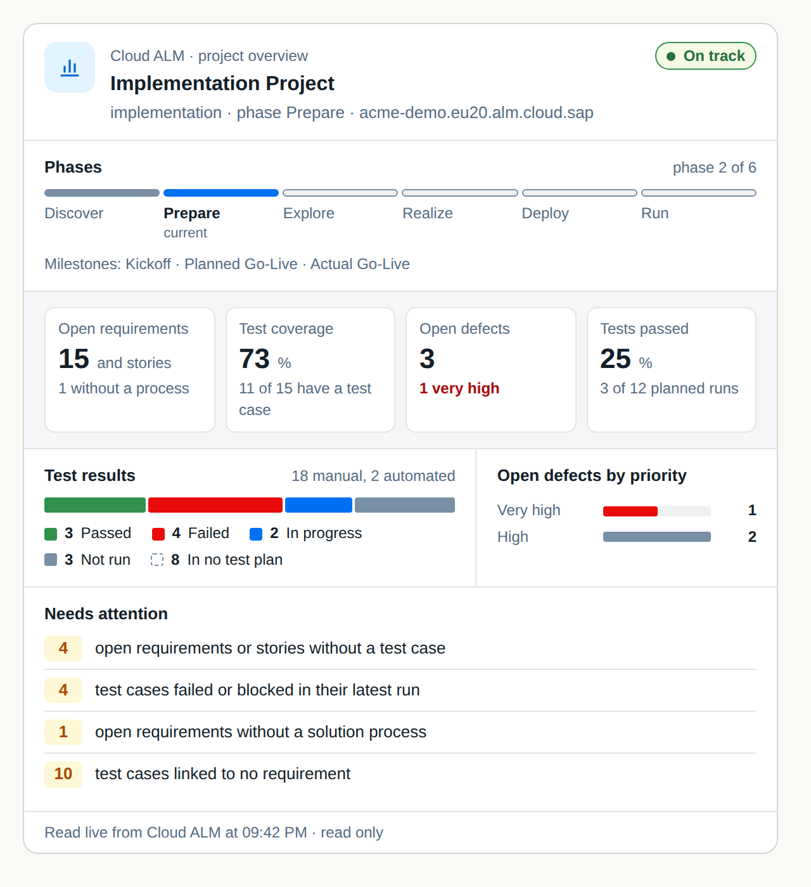

# SAP Cloud ALM for your AI assistant

[](https://www.npmjs.com/package/cloud-alm-mcp-server)
[](https://github.com/DidroAI/cloud-alm-mcp-server/actions/workflows/ci.yml)
[](LICENSE)

Ask your SAP Cloud ALM project questions in Claude, ChatGPT-style agents,
Codex, Cursor or VS Code, and let the assistant prepare changes that you
approve, field by field. An open-source [MCP](https://modelcontextprotocol.io)
server, `cloud-alm-mcp-server`.

- *"Where does the project stand, and what changed since Friday?"*
- *"What blocks UAT exit? List failed tests with their defects and the
  requirements without a test."*
- *"Prepare the fit-gap workshop for Order to Cash."*
- *"Lower 3-14 to high, due Friday, and add a note that pricing fixes it."*
  → an approval card shows the change; nothing is written until you click
  **Approve**.

<p>


</p>

> Beta (0.1.0-beta.2). MIT licence. An independent open-source project, not
> affiliated with or endorsed by SAP. SAP and SAP Cloud ALM are trademarks of
> SAP SE.

## How it works

- **Your key, your machine.** The server runs on your computer with a
  service key of the *SAP Cloud ALM API* from your SAP BTP subaccount. No
  telemetry; it talks only to SAP ([PRIVACY.md](PRIVACY.md)).
- **The key decides.** A read-only key reads. A key with write scopes also
  lets the assistant *propose* changes: create, update, comment, link, tag,
  delete. Every change waits for your approval in a card (or your "yes" in
  the chat).
- **Links back to Cloud ALM.** Items come with a link that opens them in the
  Cloud ALM UI, and you can paste a Cloud ALM link wherever an id is asked.

## 1. Get a service key

Someone with admin rights in the SAP BTP subaccount of your Cloud ALM tenant
creates an instance of the **SAP Cloud ALM API** service with the scopes in
[scopes/read-only.json](scopes/read-only.json) (or
[read-write.json](scopes/read-write.json)), creates a binding, and downloads
its JSON. Step by step, with an e-mail you can send to your BTP admin:
[docs/service-key.md](docs/service-key.md).

## 2. Install

**Any client, one command** (needs [Node.js 22+](https://nodejs.org)):

```sh
npx -y cloud-alm-mcp-server@beta setup
```

It finds the key you downloaded in `~/Downloads`, checks it against SAP,
saves it readable only by you, and adds the server to Claude Code, Codex,
Claude Desktop and Cursor, whichever are installed. Then open a new chat
(quit and reopen Claude Desktop) and ask: *"Where does my Cloud ALM project
stand?"*

Or pick your client:

| Client | How |
| --- | --- |
| Claude Desktop | [](https://github.com/DidroAI/cloud-alm-mcp-server/releases/latest/download/cloud-alm-mcp-server.mcpb) Download, double-click, choose your key file. No terminal, no Node.js. |
| Claude Code | `/plugin install cloud-alm --marketplace DidroAI/cloud-alm-mcp-server` (server and skills) |
| Cursor | [](https://cursor.com/install-mcp?name=cloud-alm&config=eyJjb21tYW5kIjoibnB4IiwiYXJncyI6WyIteSIsImNsb3VkLWFsbS1tY3Atc2VydmVyQGJldGEiXX0%3D) after `setup` saved the key |
| VS Code (Copilot) | [](https://vscode.dev/redirect?url=vscode%3Amcp%2Finstall%3F%257B%2522name%2522%253A%2522cloud-alm%2522%252C%2522command%2522%253A%2522npx%2522%252C%2522args%2522%253A%255B%2522-y%2522%252C%2522cloud-alm-mcp-server%2540beta%2522%255D%257D) after `setup` saved the key |
| Codex | `setup` adds it; by hand: `codex mcp add cloud-alm -- npx -y cloud-alm-mcp-server@beta` |

All channels, by hand and in detail: [docs/install.md](docs/install.md).

### Let your agent set it up

Download the key, then give Claude Code, Codex or any agent with a terminal
this prompt:

> Set up the SAP Cloud ALM MCP server for me: run
> `npx -y cloud-alm-mcp-server@beta setup` in a terminal. It finds the
> service key JSON I downloaded from SAP BTP, checks it, saves it and adds
> the server to my MCP clients. Don't open or print the key file. If it
> finds no key, ask me for the file's path and run
> `npx -y cloud-alm-mcp-server@beta setup <path>`. Then tell me what it
> printed and which apps to restart.

## 3. Ask

| You want | Ask, for example |
| --- | --- |
| The state of the project | "Where does the project stand?" |
| What moved | "What changed since Monday?" |
| Traceability | "Trace REQ-04: stories, features, transports, tests, defects." |
| Gaps and audit | "Which requirements have no passing test?" |
| Test readiness | "Are we ready to exit UAT?" |
| Who | "Who in the team can I assign the export defects to?" |
| SAP services | "Is there planned maintenance on our systems?" |

The tools behind these answers: [docs/tools.md](docs/tools.md).

## Skills: whole workflows

`skills/` holds agent skills for the work of a functional consultant; the
server also offers each one as an MCP prompt (pick it from your client's
prompt or slash-command menu):

| Skill | For |
| --- | --- |
| `cloud-alm-explore` | answering questions: which tool for which question |
| `cloud-alm-fit-gap` | fit-to-standard: fit, configuration or gap per requirement and process |
| `cloud-alm-workshop-prep` | agenda, open questions and decisions for a workshop |
| `cloud-alm-backlog-from-notes` | minutes or a transcript into requirements, user stories, tasks and comments |
| `cloud-alm-daily-brief` | what moved since yesterday, what is at risk, what is due |
| `cloud-alm-status-report` | a steering committee or weekly status report |
| `cloud-alm-test-readiness` | SIT/UAT entry and exit, go-live readiness, go / no-go |
| `cloud-alm-defect-triage` | duplicates, priority, owner and due date of open defects |
| `cloud-alm-test-design` | test cases for what is untested |

For Claude Code, copy a skill's folder to `~/.claude/skills/`; for other
agents, use the prompts or point the agent to the SKILL.md.

## Approving changes

When the assistant wants to change Cloud ALM, the tool only *proposes*: you
see the change field by field (before → after, what is created, what is
deleted) and click **Approve** or **Reject**. In apps without cards, the
assistant shows the change and waits for your "yes". Before writing, the
server checks the change still matches what you saw. Details and limits:
[docs/tools.md#approving-writes](docs/tools.md#approving-writes).

## Update, rotate, uninstall

```sh
npx -y cloud-alm-mcp-server@beta doctor      # check key, token, scopes, API, Node
npx -y cloud-alm-mcp-server@beta setup       # again after rotating the key
npx -y cloud-alm-mcp-server@beta uninstall   # remove it from your apps (--key: also the saved key)
```

Client configs run `cloud-alm-mcp-server@beta`, so you get updates on the
next start.

## Troubleshooting

- **"Cloud ALM is not set up yet"** in the app's MCP log: run `setup`, or
  choose the key file in the extension or plugin settings.
- **Token or API errors**: run `doctor`; it names the failing step. A
  corporate proxy or TLS inspection can block `npx` or SAP: set
  `HTTPS_PROXY` and `NODE_EXTRA_CA_CERTS` as your IT advises.
- **"not readable with this key"**: the key lacks a scope; ask for the
  scope named in the answer ([docs/service-key.md](docs/service-key.md)).
- **Claude Desktop does not show the server**: quit it fully (also from the
  tray / menu bar) and reopen.

## Security

Reads are GET only, to `*.alm.cloud.sap` only. Writes go to a fixed
allow-list of SAP APIs and only after your approval. The key is stored
readable only by you and never printed or sent to the model. Text from Cloud
ALM reaches the model marked as data. A key opens the whole tenant (SAP
cannot limit it to one project): give read-only keys to whoever only reads.
More: [SECURITY.md](SECURITY.md), [PRIVACY.md](PRIVACY.md).

## More

- [Tools and outputs](docs/tools.md)
- [Getting a service key](docs/service-key.md)
- [All install channels](docs/install.md)
- [Running it as a shared HTTP endpoint](docs/hosting.md)
- [Using it as a library](docs/library.md)
- [Cloud ALM API notes, errors and limits](docs/cloud-alm-api.md)
- [Contributing](CONTRIBUTING.md) · [Changelog](CHANGELOG.md) · [Code of conduct](CODE_OF_CONDUCT.md)

## Licence

MIT: see [LICENSE](LICENSE).
