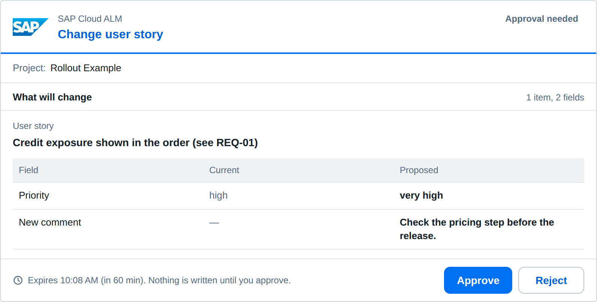

# SAP Cloud ALM for your AI assistant

[](https://www.npmjs.com/package/cloud-alm-mcp-server)
[](https://github.com/DidroAI/cloud-alm-mcp-server/actions/workflows/ci.yml)
[](LICENSE)

Ask your SAP Cloud ALM project questions in Claude, ChatGPT-style agents,
Codex, Cursor or VS Code, and let the assistant prepare changes that you
approve, field by field. An open-source [MCP](https://modelcontextprotocol.io)
server, `cloud-alm-mcp-server`.

For a browser-only connection to your own tenant, try the [hosted ChatGPT and Claude connector](https://docs.didro.ai/cloud-alm/#install). Choose your BTP service key during sign-in to start a read-only session of up to one hour.

[Try the hosted demo with synthetic data](https://docs.didro.ai/cloud-alm/#hosting) or [connect your own SAP tenant](https://docs.didro.ai/cloud-alm/#install).

For local clients, download your Cloud ALM API service key and run `npx -y cloud-alm-mcp-server setup` in a terminal with Node.js 22 or later; it asks which key and which apps. Claude Desktop users can also [install the extension](https://github.com/DidroAI/cloud-alm-mcp-server/releases/latest/download/cloud-alm-mcp-server.mcpb) and choose their key file.

- *"Where does the project stand, and what changed since Friday?"*
- *"What blocks UAT exit? List failed tests with their defects and the
  requirements without a test."*
- *"Prepare the fit-gap workshop for Order to Cash."*
- *"Lower 3-14 to high, due Friday, and add a note that pricing fixes it."*
  → an approval card shows the change; nothing is written until you click
  **Approve**.

<p>


</p>

> MIT licence. An independent open-source project, not
> affiliated with or endorsed by SAP. SAP and SAP Cloud ALM are trademarks of
> SAP SE.

## How it works

- **Your key, your machine.** The server runs on your computer with a
  service key of the *SAP Cloud ALM API* from your SAP BTP subaccount. No
  background telemetry. It connects to SAP and, when your assistant reports a tool problem, to Didro ([PRIVACY.md](PRIVACY.md)).
- **The key decides.** A read-only key reads. A key with write scopes also
  lets the assistant *propose* changes: create, update, comment, link, tag,
  delete. Every change waits for your approval in a card (or your "yes" in
  the chat).
- **Links back to Cloud ALM.** With a tenant UI address, record cards can open
  requirements, defects, tasks, features, documents and manual test cases directly.
  Test plans, automated test cases and processes open their SAP list. Project
  links open the launchpad. Dashboard counts and approval fields are plain text.
  The synthetic demo has no tenant links.

### Browsing results in chat

In clients with MCP Apps, project lists, search results and item details open
as cards. Use the Cloud ALM links to open the source record or its SAP app. **View all** expands
a compact list in hosts with fullscreen support. **Load more** fetches the
next page with the same filters. Clients that use text receive the read result.

For a host that supports MCP Apps and tool calls from a card, set
`CALM_CONTENT_PRESENTATION=explicit` in the server environment to show only
the final selection. The assistant reads the data, then calls `calm_show`
with selected IDs or list filters. The card fetches those records when it
opens. For a text answer or an export, the assistant can skip that last call.

### Agent feedback

Your assistant can report missing fields, unexpected results or extra tool calls to Didro’s private inbox with `calm_report_feedback`. A report is the tool's name, the outcome, one or two generic sentences, the server's version and a random report ID: no records, credentials or chat text ([PRIVACY.md](PRIVACY.md)). It is on by default in a local install, whichever way you installed; turn it off with `npx -y cloud-alm-mcp-server feedback off` (every app on this computer) or `CALM_FEEDBACK=off` (one app's configuration). How to do that for the Claude Desktop extension, the Claude Code plugin and a registry install: [docs/install.md#reports-about-tool-problems](docs/install.md#reports-about-tool-problems). Operators can send the reports to a receiver of their own with `CALM_FEEDBACK_URL`. [Agent feedback guide](https://docs.didro.ai/cloud-alm/#feedback)

## Setup in 2 minutes (video)

https://github.com/user-attachments/assets/aacac950-e66e-4121-917b-c7a88c85df6f

Every click in SAP BTP, then `setup` in a terminal, or one prompt to your
coding agent. With narration, 2 minutes. No player here?
[Open the video file](docs/media/setup-tutorial.mp4).

## 1. Get a service key

Someone with admin rights in the SAP BTP subaccount of your Cloud ALM tenant
creates an instance of the **SAP Cloud ALM API** service with the scopes in
[scopes/read-only.json](scopes/read-only.json) (or
[read-write.json](scopes/read-write.json)), creates a binding, and downloads
its JSON. Step by step, with an e-mail you can send to your BTP admin:
[docs/service-key.md](docs/service-key.md), or watch it in the
[setup video](#setup-in-2-minutes-video).

## 2. Install

**Local clients, one command** (needs [Node.js 22+](https://nodejs.org)):

```sh
npx -y cloud-alm-mcp-server setup
```

In a terminal, `setup` asks its way through:

1. **Which service key?** Type the path of the key file (or drag the file
   into the window), or paste the key; a pasted key is not shown. A key
   found in `~/Downloads` from the last week and the key saved before are
   offered too.
2. It checks the key against SAP (a token, its scopes, one read) and saves
   it readable only by you.
3. **Which apps?** Claude Code, Codex, Claude Desktop and Cursor, the ones
   installed, all ticked; untick what you do not want.
4. **The skills too?** Yes or no ([Skills](#skills-whole-workflows)).
5. It prints what was done per app and what to do next: what to restart,
   and a first question to ask.

`setup <file>` names the key up front and skips the first question. Run by
an AI agent, in CI or through a pipe, or with `--no-input`, setup asks
nothing: it takes the file named, else the newest key in `~/Downloads` from
the last week, else the key saved before, adds the server to every app
installed and installs the skills. `--client <list>` chooses the apps and
`--no-skills` leaves the skills out, with or without questions. All options:
[docs/install.md](docs/install.md#1-local-clients-the-setup-command-recommended).

Or pick your client:

| Client | How |
| --- | --- |
| Claude Desktop | [](https://github.com/DidroAI/cloud-alm-mcp-server/releases/latest/download/cloud-alm-mcp-server.mcpb) Download, double-click, choose your key file. No terminal, no Node.js. |
| Claude Code | `/plugin install cloud-alm --marketplace DidroAI/cloud-alm-mcp-server` (server and skills). Instead of `setup` for Claude Code, not as well: [one or the other](docs/install.md#3-claude-code-plugin-server-and-skills) |
| Cursor | [](https://cursor.com/install-mcp?name=cloud-alm&config=eyJjb21tYW5kIjoibnB4IiwiYXJncyI6WyIteSIsImNsb3VkLWFsbS1tY3Atc2VydmVyIl19) after `setup` saved the key |
| VS Code (Copilot) | [](https://vscode.dev/redirect?url=vscode%3Amcp%2Finstall%3F%257B%2522name%2522%253A%2522cloud-alm%2522%252C%2522command%2522%253A%2522npx%2522%252C%2522args%2522%253A%255B%2522-y%2522%252C%2522cloud-alm-mcp-server%2522%255D%257D) after `setup` saved the key |
| Codex | `setup` adds it; by hand: `codex mcp add cloud-alm -- npx -y cloud-alm-mcp-server` |

All channels, by hand and in detail: [docs/install.md](docs/install.md).

### Or let your agent do it

Download the key, then paste this into Claude Code, Codex, Cursor's agent or
any assistant with a terminal:

```text
Set up the SAP Cloud ALM MCP server for me: run `npx -y cloud-alm-mcp-server setup` and follow what it prints (instructions for agents: https://github.com/DidroAI/cloud-alm-mcp-server/blob/main/docs/agent-setup.md). Never open or print my service key file.
```

Tested with Codex and Claude Code: they run `setup`, check with `doctor`,
and tell you what to restart, without reading the key.
[What the agent follows](docs/agent-setup.md).

## 3. Ask

| You want | Ask, for example |
| --- | --- |
| The state of the project | "Where does the project stand?" |
| What moved | "What changed since Monday?" |
| Traceability | "Trace REQ-04: stories, features, transports, tests, defects." |
| Gaps and audit | "Which requirements have no passing test?" |
| Test readiness | "Are we ready to exit UAT?" |
| Who | "Who in the team can I assign the export defects to?" |
| SAP services | "Is there planned maintenance on our systems?" |

The tools behind these answers: [docs/tools.md](docs/tools.md).

## Skills: whole workflows

`skills/` holds agent skills for the work of a functional consultant; the
server also offers each one as an MCP prompt (pick it from your client's
prompt or slash-command menu):

| Skill | For |
| --- | --- |
| `cloud-alm-explore` | answering questions: which tool for which question |
| `cloud-alm-fit-gap` | fit-to-standard: fit, configuration or gap per requirement and process |
| `cloud-alm-workshop-prep` | agenda, open questions and decisions for a workshop |
| `cloud-alm-backlog-from-notes` | minutes or a transcript into requirements, user stories, tasks and comments |
| `cloud-alm-daily-brief` | what moved since yesterday, what is at risk, what is due |
| `cloud-alm-status-report` | a steering committee or weekly status report |
| `cloud-alm-test-readiness` | SIT/UAT entry and exit, go-live readiness, go / no-go |
| `cloud-alm-defect-triage` | duplicates, priority, owner and due date of open defects |
| `cloud-alm-test-design` | test cases for what is untested |

`setup` copies them to where Claude Code (`~/.claude/skills`, or
`$CLAUDE_CONFIG_DIR/skills`), Codex (`~/.agents/skills`) and Cursor read
skills; Cursor reads one of those two folders, and gets `~/.cursor/skills`
only when neither was written. The wizard asks first; `--no-skills` skips
them. Claude Desktop reads no skills from disk: there, and in other apps,
use the prompts, or point the agent to the SKILL.md.

## Approving changes

When the assistant wants to change Cloud ALM, the tool only *proposes*: you
see the change field by field (before → after, what is created, what is
deleted) and click **Approve** or **Reject**. In apps without cards, the
assistant shows the change and waits for your "yes". Before writing, the
server checks the change still matches what you saw. Details and limits:
[docs/tools.md#approving-writes](docs/tools.md#approving-writes).

## Update, rotate, uninstall

```sh
npx -y cloud-alm-mcp-server doctor      # check Node, key, token, scopes, API; say whether reports are on
npx -y cloud-alm-mcp-server setup       # again after rotating the key
npx -y cloud-alm-mcp-server feedback    # are reports about tool problems on? (feedback off / feedback on)
npx -y cloud-alm-mcp-server uninstall   # remove it and its skills from your apps (--key: also the saved key)
```

Settings are environment variables in the app's server entry:
[docs/install.md#environment-variables](docs/install.md#environment-variables).

Client configs run `cloud-alm-mcp-server`, so you get updates on the
next start.

## Troubleshooting

- **"Cloud ALM is not set up yet"** in the app's MCP log: run `setup`, or
  choose the key file in the extension or plugin settings.
- **Token or API errors**: run `doctor`; it names the failing step. A
  corporate proxy or TLS inspection can block `npx` or SAP: set
  `HTTPS_PROXY` and `NODE_EXTRA_CA_CERTS` as your IT advises. Node follows
  `HTTPS_PROXY` only when `NODE_USE_ENV_PROXY=1` is set as well (Node 24).
- **"not readable with this key"**: the key lacks a scope; ask for the
  scope named in the answer ([docs/service-key.md](docs/service-key.md)).
- **Claude Desktop does not show the server**: quit it fully (also from the
  tray / menu bar) and reopen.

## Security

Reads are GET only, to `*.alm.cloud.sap` only. Writes go to a fixed
allow-list of SAP APIs and only after your approval. The key is stored
readable only by you and never printed or sent to the model. Text from Cloud
ALM reaches the model marked as data. A key opens the whole tenant (SAP
cannot limit it to one project): give read-only keys to whoever only reads.
More: [SECURITY.md](SECURITY.md), [PRIVACY.md](PRIVACY.md).

## More

- [Tools and outputs](docs/tools.md)
- [Getting a service key](docs/service-key.md)
- [All install channels](docs/install.md)
- [Running it as a shared HTTP endpoint](docs/hosting.md)
- [Using it as a library](docs/library.md)
- [Cloud ALM API notes, errors and limits](docs/cloud-alm-api.md)
- [Contributing](CONTRIBUTING.md) · [Changelog](CHANGELOG.md) · [Code of conduct](CODE_OF_CONDUCT.md)

## Licence

MIT: see [LICENSE](LICENSE).
