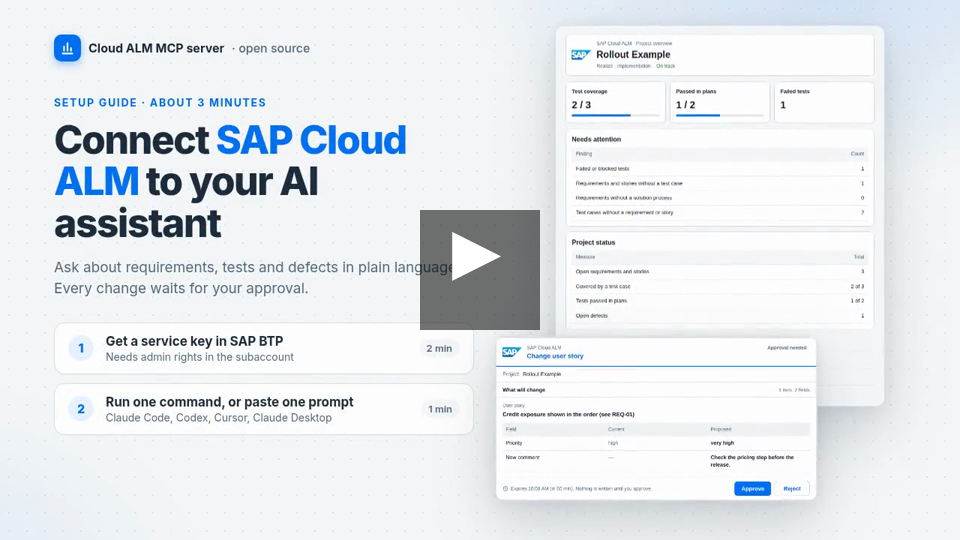

# Getting a service key

For whoever administers the SAP BTP subaccount of your Cloud ALM tenant. Back to the [README](../README.md).

The setup video (2 minutes, with sound) shows every click below:

[](media/setup-tutorial.mp4)

Cloud ALM's APIs take an OAuth token from a **service key** of the "SAP Cloud
ALM API" service, created in the BTP subaccount where your Cloud ALM tenant
lives. Nothing is deployed; the instance only registers an OAuth client.

1. In the BTP cockpit, open the Cloud ALM subaccount → *Services* →
   *Instances and Subscriptions* → *Create*.
2. Service **SAP Cloud ALM API**, plan **standard**, runtime environment
   **Other**. Name it, e.g. `calm-read`.
3. Parameters: paste one of the scope files of this repository (the
   default template has no scopes, which gives a token that can read
   nothing):

   - [`scopes/read-only.json`](../scopes/read-only.json): the agent reads;
   - [`scopes/read-write.json`](../scopes/read-write.json): it may also
     propose changes to tasks, test cases, features and documents, each
     one waiting for your approval.

   Change `xsappname` if the name is taken in your subaccount. The
   read-only file looks like this:

   ```json
   {
     "xs-security": {
       "xsappname": "calm-read",
       "authorities": [
         "$XSMASTERAPPNAME.calm-api.projects.read",
         "$XSMASTERAPPNAME.calm-api.tasks.read",
         "$XSMASTERAPPNAME.calm-api.tasks.personal.read",
         "$XSMASTERAPPNAME.calm-api.features.read",
         "$XSMASTERAPPNAME.calm-api.documents.read",
         "$XSMASTERAPPNAME.calm-api.testcases.read",
         "$XSMASTERAPPNAME.calm-api.testplans.read",
         "$XSMASTERAPPNAME.calm-api.processmanagement.read",
         "$XSMASTERAPPNAME.calm-api.processhierarchy.read",
         "$XSMASTERAPPNAME.calm-api.landscape.read",
         "$XSMASTERAPPNAME.calm-api.lib.read",
         "$XSMASTERAPPNAME.calm-api.analytics.read",
         "$XSMASTERAPPNAME.calm-api.analytics.providers.read",
         "$XSMASTERAPPNAME.calm-api.bsm.read",
         "$XSMASTERAPPNAME.calm-api.tests.read",
         "$XSMASTERAPPNAME.calm-api.defects.read",
         "$XSMASTERAPPNAME.calm-api.requirements.read"
       ]
     }
   }
   ```

   Add only what you will read. Analytics datasets also need their area's
   scope (`calm-api.tasks.read` for `Tasks`, `…defects.read`,
   `…requirements.read`, `…tests.read`, …), and operations datasets their
   own (`…metrics.read`, `…jobs.read`, `…exm.read` …). Personal fields
   (assignee names) need `calm-api.tasks.personal.read` and its siblings.
4. Create a **service binding** (the key) on the instance and download its
   JSON. Then run `npx -y cloud-alm-mcp-server setup` in a terminal. It
   asks which key to use: it offers a key downloaded to `~/Downloads` in
   the last week, or you type the file's path, or paste the key (it is not
   shown). It checks the key against SAP, saves a copy readable only by
   you, asks which apps to add the server to and whether to install the
   skills, and says what to restart. Run by an AI agent or with
   `--no-input` it asks nothing and takes the newest key in `~/Downloads`
   ([install.md](install.md#1-local-clients-the-setup-command-recommended)).
   Once the key is saved you can delete the download. Never put the key in
   a repository.

The key holds `uaa.url`, `uaa.clientid`, `uaa.clientsecret` and
`endpoints.Api` (e.g. `https://eu20.alm.cloud.sap/api`, regional; the token
selects your tenant). The token carries no user: calls run as a machine
with access to the whole tenant. SAP cannot limit a key to one project.

Changed the scopes? The token reflects them at once: rerun
`npx -y cloud-alm-mcp-server doctor`. Rotated the key? Download the new one
and run `setup` again.

## Asking your BTP administrator

If you cannot create service instances yourself, send this to whoever
administers the SAP BTP subaccount of your Cloud ALM tenant:

> Hello,
>
> I'd like to use SAP Cloud ALM from my AI assistant (an open-source MCP
> server: github.com/DidroAI/cloud-alm-mcp-server). Could you create an
> instance of the **SAP Cloud ALM API** service (plan *standard*, runtime
> *Other*) in our Cloud ALM subaccount, with the parameters in
> [scopes/read-only.json](https://github.com/DidroAI/cloud-alm-mcp-server/blob/main/scopes/read-only.json)
> (or read-write.json if I should be able to propose changes), create a
> service binding on it, and send me its JSON through a secure channel?
>
> The key only reads Cloud ALM with these scopes; it stays on my laptop
> (readable only by me) and is sent only to SAP: to its token host, and
> from there a token to `*.alm.cloud.sap`. It can be revoked at any time by
> deleting the binding.

## Rotating or revoking a key

- **Rotate:** create a new binding, download it, run `setup` again and
  choose the new file (a key of the same tenant replaces the saved one;
  for another tenant setup asks first), then delete the old binding.
- **Revoke:** delete the binding in the BTP cockpit; every token from it
  stops working when it expires (within the hour).
